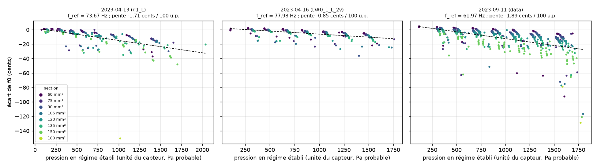
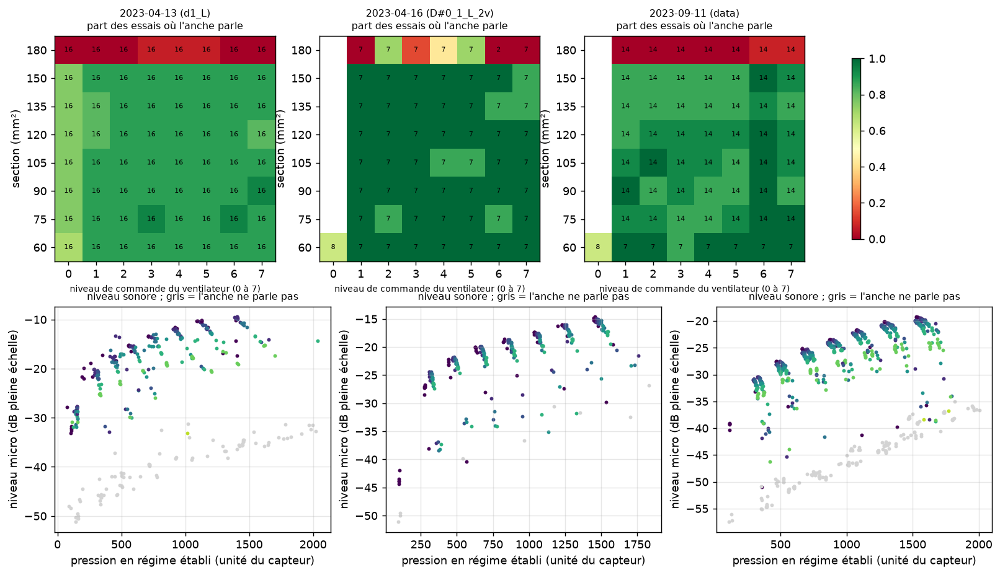
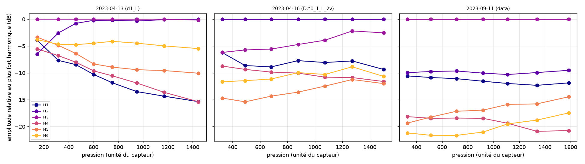
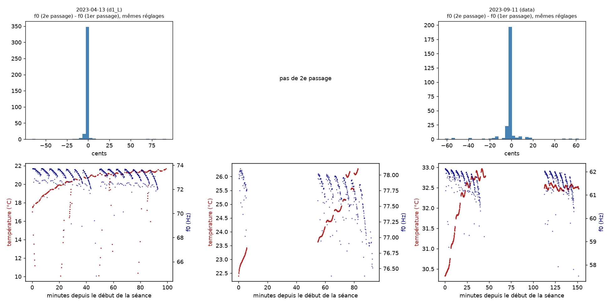
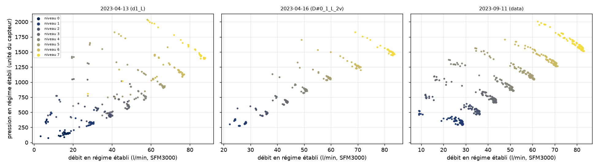

# Les mesures de la thèse sur l'anche libre : ce qu'il y a, ce qu'on en tire, ce qu'on peut en faire

Date : 01/10/2026. Auteur : agent chercheur-acoustique. Brouillon à relire par Ewen.

Lecture seule : aucun fichier de mesure n'a été déplacé, renommé ou modifié.
Tout ce que j'ai produit est dans `J:\claude\business-os\journal\recherche\` :

- `mesures-these-anche-libre.md` : ce rapport ;
- `mesures_2023.csv` : une ligne par enregistrement (2 162 lignes), avec pression, débit,
  température, fréquence de jeu, harmoniques ;
- `analyses_rapides.txt` : les chiffres bruts des analyses ;
- `figures\` : 5 figures ;
- `scripts\` : les scripts qui refont tout (`extraire_mesures.py` puis `analyses_rapides.py`,
  environ 12 minutes). Ils ne font que lire les données.

---

## En bref (5 lignes)

1. Il y a **4 campagnes de mesure, toutes de 2023** (janvier, avril deux fois, septembre).
   Rien de 2022 ni de 2024 dans ces dossiers : 2022, ce sont des scripts de test ; 2024, c'est
   la date de copie sur le Drive.
2. **Trois campagnes sont exploitables** : 2 162 sons de 3 secondes, avec la pression, le débit
   et la température. Les trois anches jouent à environ 73,3 Hz, 77,8 Hz et 61,7 Hz.
3. Ce qu'on voit déjà, de façon sûre : **l'anche baisse de 1 à 2 cents par 100 Pa** de souffle.
   Ça fait 15 à 35 cents entre le souffle le plus faible et le plus fort. Le son monte de 11 à
   20 dB. Et au dernier cran de « section », l'anche se tait presque toujours.
4. On mesure aussi, sans l'avoir cherché, **la résistance interne de la soufflerie**. Elle
   vaut à peu près 10⁶ Pa·s/m³, soit environ 100 fois moins que la valeur mise dans le
   modèle (2·10⁸). Il faut le vérifier en premier.
5. **Le grand manque, ce sont les métadonnées.** On ne sait pas quelle anche est mesurée, ce
   qu'est exactement la « section », ni si la pression est vraiment en pascals. Une heure de
   questions et un tube en U à eau (presque gratuit) règlent l'essentiel.

---

## 1. Inventaire

### Le banc (d'après les scripts)

- **Pyboard n°1** (`MesAnche.py`) : capteur de pression et de température BMP280, débitmètre
  SFM3000, vis motorisée qui règle la « section ». Mesure à environ 100 Hz pendant 3 s.
- **Pyboard n°2** (`valvecontrol.py`) : commande du ventilateur (DAC de 300 à 3 500 sur 4 095)
  et du clapet motorisé (angle de 2 à 22°).
- **PC** (`Mesures.py`) : orchestre le plan d'expérience et enregistre le micro (48 kHz, 3 s).
- **Plan** : 8 sections × 8 pressions × 8 angles de clapet. Puis une seconde passe identique
  (indice `PPos`).
- **Déroulé d'un essai** : le clapet s'ouvre pendant l'enregistrement (vers 0,5 s), l'anche
  démarre, puis le régime est établi. J'ai analysé la fin du son, de 2,0 à 3,0 s.

### Les campagnes

Les dossiers sont dans `D:\GoogleDrive\python\Mesure anches\`. L'heure vient de l'horodatage
des fichiers son. Ce sont de vraies heures d'acquisition : un son toutes les 5 à 6 s.

| Campagne | Date et heure | Anche (f0 mesurée) | Contenu | Volume | Exploitable ? |
|---|---|---|---|---|---|
| `data - e1` | 21/01/2023, vers 14 h | inconnue (spectres confus) | grille 2×5×5×5 ; son 2 s (PyTTa) ; 50 HDF5 et 7 `.npy` | 771 Mo | **Faible.** La pression est figée (0 ou 654,9 partout). La voie « accéléromètre » est une copie du micro. Les 50 HDF5 ne gardent que le dernier clapet. Utilisable seulement contre le niveau de commande. |
| `data_d1_L` | 13/04/2023, 20 h 26 à 22 h 05 | **73,3 Hz** (ré1 en notation française, D2 en notation internationale) | 1 024 sons (grille complète, 2 passes) ; pneumatique en `.npy` | 579 Mo **+ 2,3 Go** (voir plus bas) | **Oui pour le son.** Pneumatique : seuls 343 essais sur 1 024 sont lisibles. Dans les autres, le transfert série a mélangé les lignes temps et valeurs. 14 sons saturent le micro. |
| `data_D#0_1_L_2v` | 16/04/2023, 17 h 33 à 19 h 06 | **77,8 Hz** (ré#2 en notation internationale ; le nom « D#0 » suit une autre convention, à confirmer) | 395 sons, 1re passe seulement, arrêtée à section 7, pression 6 ; HDF5 | 546 Mo | **Oui.** 302 essais ont une pneumatique propre. Il n'y a pas de seconde passe. |
| `data` | 11/09/2023, 18 h 01 à 20 h 32 | **61,7 Hz** (si0 en notation française, B1 en notation internationale) | 743 sons sur 2 passes ; HDF5 complet ; 745 figures Praat (PNG) | 4,2 Go | **Oui, la meilleure.** La pneumatique est propre partout. Le niveau de pression 0 et le clapet 0 manquent, sauf pour la section 0. |

Total utile : **2 162 enregistrements** (1 024 + 395 + 743), dont **1 388** avec une
pneumatique lisible et plausible.

### Pièges à connaître (et à dire au rangeur)

- **`data\d_Mesures_Press_Acoustique.npy` (2,3 Go) n'appartient pas à la campagne de
  septembre.** Il est identique, échantillon pour échantillon, aux sons de `data_d1_L`
  (13/04/2023). C'est un doublon rangé au mauvais endroit. Avec le rangement en cours, il faut
  le rattacher à `data_d1_L`, ou le marquer comme doublon. Ne pas le supprimer sans l'accord
  d'Ewen.
- **Les fichiers son** sont des WAV en virgule flottante, avec des valeurs d'environ 10⁸ :
  c'est du 32 bits entier mal étiqueté. Il faut diviser par 2³¹ pour retrouver la pleine
  échelle. Un lecteur audio ordinaire les fait saturer, alors que les données sont bonnes.
- **Les sections réelles** : la vis ne bouge que par millimètres entiers (`int()` dans
  `Move_to_Pos`). Les sections sont donc 60, 75, 90, 105, 120, 135, 150 puis **180** mm², et pas
  8 pas égaux. Le dernier pas est double. `Calculs_Surf` dans les fichiers confirme ces valeurs.
- **La « seconde passe » (`PPos` = 1)** : la boucle ne commande rien de différent. C'est une
  **répétition** des mêmes réglages. La pression mesurée est positive dans les deux cas, donc
  ce n'est pas une aspiration. C'est une chance : ça mesure la répétabilité.
- **Le clapet** : au-delà d'environ 10° (indice 3 et plus), il ne change plus ni la pression
  ni le débit. Seuls les deux premiers angles comptent.
- **Les fréquences Praat déjà rangées** dans le HDF5 de septembre (`Freq`, `Results`) sont
  fausses d'environ 5 Hz : 56,5 Hz au lieu de 61,7 Hz. Ne pas les réutiliser telles quelles.

### Ce qui manque

| Manque | Pourquoi ça compte | Comment le combler, pour pas cher |
|---|---|---|
| **Quelle anche** (matière, longueur, largeur, épaisseur, note, sommier, volume de la chambre) | Sans ça, aucune comparaison avec le modèle ni avec Elmer | Ewen écrit une fiche par campagne. S'il a encore les anches : photo sur papier millimétré, pied à coulisse, palmer |
| **Unité et étalonnage de la pression** | Le pilote BMP280 trouvé sur le Drive renvoie des hPa absolus (≈ 1 013) et garde sa première valeur en mémoire. Les valeurs enregistrées (55 à 2 040) ne collent pas avec ce pilote. La version du Pyboard n'est pas archivée | Tube en U avec de l'eau (1 mm d'eau ≈ 9,8 Pa), branché en parallèle sur la chambre, à 3 ou 4 pressions. Coût : un tuyau et une règle |
| **Ce qu'est la « section »** | Quand la « surface » augmente, la pression monte et le débit baisse, comme si le passage se fermait. Au dernier cran, l'anche se tait | Ewen décrit la pièce ou envoie une photo du banc |
| **Le micro** (modèle, distance, pièce) | Les niveaux ne sont que relatifs (dB pleine échelle) ; le spectre est coloré par le micro et la pièce | Noter le modèle et la position. Plus tard, un calibreur 94 dB emprunté, ou une comparaison avec un sonomètre de téléphone (ordre de grandeur seulement) |
| **Le seuil d'oscillation** | Dans la plupart des séries, l'anche parle déjà au premier niveau mesuré | Une rampe lente dédiée (piste 3) |
| **Un point témoin pour la dérive** | La température monte de 2 à 4 °C pendant une séance. On ne peut pas séparer dérive et effet des réglages | Rejouer le même réglage tous les 50 essais |

### Le reste (Elmer et le dossier acoustique)

- **`D:\GoogleDrive\Lutherie\Simulations d'anche (Elmer)`** :
  - `bass_reed` (août 2020) : calcul modal d'une anche basse en acier, 5 modes demandés. Le
    maillage mesure 46 × 8 × 1,5 mm. Mais **aucun résultat n'est enregistré**. Et la condition
    aux limites ne bloque qu'une direction (`Displacement 3 = 0`), donc l'anche n'est pas
    vraiment encastrée : le calcul donnerait des modes de corps rigide.
  - `Reed_with_cav` (mai 2021) : géométrie et maillage anche + cavité, mais pas de solveur
    réglé.
  - `Tfork` : un exemple de diapason, ce n'est pas une anche.
  - Le dépôt a des calculs Elmer plus récents (`research/cfd/sandwich2d`).
- **`D:\GoogleDrive\labo de zao\acoustique`** (2019-2021) :
  - surtout une bibliothèque d'articles (Ricot, St Hilaire, Millot, Cottingham…) ;
  - des modèles COMSOL et des CAO anche + cavité ;
  - 2 sons d'essai (`reed.wav`, `reed1.WAV`).
  - Pas de campagne de mesure.

---

## 2. Ce qu'on en tire déjà (analyses rapides et sûres)

Méthode, en mots :

- **La fréquence de jeu f0** se lit sur la dernière seconde de son. Je fais un spectre fin,
  puis je moyenne les 10 premiers harmoniques ramenés au fondamental. Précision : mieux
  qu'un cent sur un son stable.
- **« L'anche parle »** veut dire : plus de 60 % de l'énergie du son tombe sur les harmoniques
  de f0. Ce critère sépare très nettement deux groupes. Les sons de souffle seul sont sous
  20 %, les sons d'anche au-dessus de 70 %.
- **La pression et le débit** sont moyennés sur la dernière seconde (régime établi).
- **Le cent** : un centième de demi-ton. Un écart de f en cents vaut 1 200 × log₂(f / f_ref).
- **Réserve** : je dis « Pa » pour la pression, mais l'unité n'est pas confirmée (voir plus
  haut). Elle est **plausible** : 100 à 2 000 Pa, c'est la plage de jeu habituelle d'un
  accordéon. Et avec 50 l/min sous 900 Pa, la loi de Bernoulli donne une ouverture efficace
  d'environ 20 mm². C'est raisonnable pour une anche basse.

### Analyse A : la fréquence baisse quand on souffle plus fort

- Pour les trois anches, **f0 baisse avec la pression** :
  - d1_L (73,7 Hz) : −1,7 cent par 100 Pa ;
  - D#0 (78,0 Hz) : −0,9 cent par 100 Pa ;
  - septembre (62,0 Hz) : −1,9 cent par 100 Pa.
- Sur toute la plage, ça fait **environ −15 à −35 cents**.
- Le signe et l'ordre de grandeur sont ceux qu'on attend pour une anche libre « soufflée
  fermée », comme l'anche d'accordéon. Le flux d'air ajoute un effet de masse et d'amortissement
  à la languette (voir Ricot et coll. 2005 ; Millot et Baumann 2007).
- Ce n'est pas une droite parfaite (R² ≈ 0,3). À pression égale, **les grandes sections
  baissent plus** : jusqu'à −2,5 cents par 100 Pa à 150 mm², contre environ −1 à 75 mm². La
  section agit donc sur l'anche par un autre chemin que la seule pression. C'est une piste.
- Pour l'accordeur et le banc d'accordage : **une anche accordée à 300 Pa sonne environ
  20 cents plus bas à 1 500 Pa.** C'est un chiffre utile au luthier.

### Analyse B : où l'anche parle, et à quel niveau

- **L'anche parle presque partout**, sauf au **dernier cran de section (180 mm²)**. Là, elle se
  tait dans 93 à 100 % des essais pour d1_L et septembre. Pour D#0, ça dépend de la pression.
  Le dernier pas de vis est double (10 → 12 mm) : il franchit sans doute une limite physique
  (passage trop fermé, ou anche « étouffée »). C'est à comprendre avec Ewen.
- **Le seuil d'oscillation n'est pas résolu.** Dans 83 séries sur 128 (d1_L), l'anche parle
  déjà au plus petit niveau, vers 100 à 150 Pa. En avril (D#0) et en septembre, le niveau 0
  manque presque partout : l'anche parle dès le niveau 1, vers 300 Pa. On sait seulement que
  **le seuil est sous environ 150 Pa** pour d1_L. Le modèle du dépôt prédit 25,8 Pa pour son
  anche de référence : on ne peut ni le confirmer ni l'infirmer avec ces données.
- **Le niveau sonore monte avec la pression puis se tasse** : +11 dB (septembre), +12 dB (D#0)
  et +20 dB (d1_L) sur la plage. Les nuages en « virgule » viennent de la section : à
  commande égale, une section plus grande donne plus de pression et un son plus faible.

### Analyse C : le timbre change avec la pression

- Pour chaque anche, l'équilibre des harmoniques bouge avec le souffle. Sur l'anche D#0, le
  centre de gravité des harmoniques passe du rang 2 au rang 4 : le son s'éclaircit. Sur
  septembre, ça bouge peu.
- **Prudence** : le micro n'est pas étalonné, et la pièce colore le grave (le fondamental est
  souvent plus faible que H2 ou H3). On ne compare donc que **des variations, pour une même
  anche**. Jamais une anche contre une autre.

### Analyse D : répétabilité et dérive

- **Répétabilité** : même réglage, deux passages, environ une heure d'écart.
  - d1_L (381 paires) : f0 est **0,9 cent plus bas** au 2e passage, avec une dispersion de
    seulement ±0,4 cent. 95 % des paires sont à moins de 5 cents.
  - Septembre (260 paires) : **−0,8 cent**, dispersion ±0,9 cent.
  - Le banc est donc **très répétable**, mieux que le cent.
- **Dérive** : pendant ce temps, la température dans le circuit d'air monte de 2 à 4 °C. Elle
  passe de 17,5 à 21,7 °C le 13/04 et de 30,3 à 33,0 °C le 11/09 : le ventilateur chauffe
  l'air. Une baisse d'environ 0,2 cent par degré est l'ordre de grandeur attendu pour une
  languette d'acier qui s'assouplit en chauffant. C'est **plausible, pas démontré** : il
  faudrait le point témoin.
- On voit aussi des **trous dans les séances** : 50 min le 16/04, 65 min le 11/09. Ce sont
  sans doute des arrêts et des reprises du script. Un tel arrêt explique aussi les cases
  manquantes.

### Analyse E (bonus) : la soufflerie elle-même

- À commande de ventilateur fixe, quand le clapet ou la section changent, **la pression baisse
  quand le débit monte**, presque en ligne droite. En septembre, le coefficient de corrélation
  r vaut −0,86 à −0,98 selon le niveau.
- La pente est la **résistance interne de la source**. C'est l'expérience E1 de
  `research/docs/experiences_a_mener.md`, déjà faite sans le savoir.
- Elle vaut 9 à 24 Pa par l/min, et grandit avec la commande. Soit **0,5 à 1,4 × 10⁶ Pa·s/m³**
  (1 l/min = 1,67 × 10⁻⁵ m³/s).
- **Le modèle du dépôt utilise 2 × 10⁸ Pa·s/m³** (`Source.impedance_pa_s_m3`) : environ
  **100 fois plus**. Si l'unité de pression est confirmée, c'est un recalage majeur. Ce
  paramètre borne l'amplitude prédite.
- Les données de septembre sont les plus propres pour ce calcul.

---

## 3. Ce qu'on pourrait en faire (3 pistes, classées)

### Piste 1 : un article court sur f0, pression et timbre de trois anches basses (le plus mûr)

- **Pourquoi** :
  - 2 162 mesures automatisées, un banc répétable à mieux qu'un cent ;
  - un résultat net (−1 à −2 cents par 100 Pa, effet de la section) ;
  - un banc bon marché qui est lui-même un sujet.
- **Pour qui** : un congrès d'acoustique en français (comme le CFA) ou international (comme
  ISMA). Ça fait aussi un chapitre « méthode et banc » de la thèse.
- **Ce qu'il faut avant** : les trois manques du tableau (quelle anche, unité de pression,
  sens de la section).
- **Prochain pas concret** : Ewen répond à 4 questions (voir la fin du rapport). Ensuite, une
  séance de 30 minutes avec le tube en U sur le banc. Je refais alors les figures en vrais Pa.

### Piste 2 : recaler le modèle anche-cavité avec la source mesurée (chapitre de la thèse)

- **Pourquoi** : la résistance de la soufflerie est mesurée (analyse E). Elle est très loin de
  la valeur du modèle. Avec la bonne valeur, le modèle doit retrouver, sans retouche :
  - la baisse de f0 avec la pression (analyse A) ;
  - la montée puis le tassement du niveau (analyse B) ;
  - le silence au dernier cran de section.
- C'est le test honnête : **« la nature ne ment pas »**. Si le modèle rate ces trois formes, on
  saura quoi reprendre.
- **Prochain pas concret** : lancer `banc_recherche.reed_model` avec R = 10⁶ Pa·s/m³ au lieu de
  2·10⁸, sur l'anche de septembre (une fois ses cotes connues). Puis superposer la courbe
  prédite f0(p) aux points de la figure 1.
- **Pour plus tard** : le calcul modal Elmer de `bass_reed`, avec un vrai encastrement, donnerait
  la fréquence propre de la languette libre. On la compare à la fréquence de jeu : c'est
  l'expérience E2.

### Piste 3 : un essai neuf, presque gratuit, pour le seuil et l'hystérésis (le cœur du livre, partie I)

- **Le manque** : on ne connaît ni le seuil de démarrage p_on ni le seuil d'extinction p_off.
  Les deux sont sous le premier niveau mesuré. Or leur écart, l'hystérésis, est le cœur de la
  thèse : il dit si la bifurcation est sous-critique.
- **Le plan d'expérience** :

  | | Détail |
  |---|---|
  | Facteurs | Sens de la rampe (montée, descente) ; vitesse de rampe (lente : environ 2 Pa/s, rapide : environ 20 Pa/s) ; section (75 et 150 mm²). Clapet fixé à 10°. |
  | Réponse | p_on, p_off, et l'amplitude au-dessus du seuil. |
  | Répétitions | 3 par combinaison, soit 24 rampes, environ 1 heure. |
  | Plage | 0 à 400 Pa seulement, là où tout se passe. |
  | Matériel | Celui du banc et `mes_seuil_autoentretien.py` (porté dans `seuil.py`), avec le tube en U pour l'étalonnage. Coût : 0 €. |

- **Pourquoi deux vitesses** : quand la pression monte vite, une anche démarre *plus tard* que
  son vrai seuil. C'est un « retard à la bifurcation », connu sur la clarinette (Bergeot et
  coll. 2013). Si p_on change avec la vitesse, la rampe lente est la bonne mesure.
- **Ce qui prouverait le contraire** : si p_on ≈ p_off à la rampe lente, la bifurcation est
  supercritique. Alors le chapitre « ce qui s'accroche » doit changer d'appui.
- **Prochain pas concret** : vérifier que `seuil.py` enregistre bien le son et la pression sur
  la même horloge. Puis faire 2 rampes d'essai sur l'anche de septembre.

---

## Les 4 questions pour Ewen (répondues : voir « Réponses d'Ewen » plus bas)

1. Quelles anches ont été mesurées le 13/04, le 16/04 et le 11/09/2023 ? (note, matière,
   l'as-tu encore ?)
2. Qu'est-ce que la « section » : une fente avant l'anche, une fuite, autre chose ?
   Une photo du banc suffit.
3. Le pilote BMP280 du Pyboard renvoyait-il la pression *moins* la pression de départ (p0),
   en Pa ?
4. Que veut dire « 2v » dans `data_D#0_1_L_2v` : deux voix, deux anches ?

## Réponses d'Ewen (02 et 03/10/2026)

1. **Les anches** (these-anches, 03/10) : « Je sais plus, ça doit être marqué dans le titre. » Ce que
   disent les noms des dossiers (déduction de Claude, à confirmer) :

   | Dossier | Date | Nom lu | f0 mesurée | Lecture proposée |
   |---|---|---|---|---|
   | `data - e1` | 21/01/2023 | e1 | inconnue | **mi1** (notation française), soit E2 ≈ 82,4 Hz [à vérifier : les spectres sont confus] |
   | `data_d1_L` | 13/04/2023 | d1, L | 73,3 Hz | **ré1** (notation française) = D2 = 73,4 Hz : le nom et la mesure collent. « L » : sens inconnu [à demander] |
   | `data_D#0_1_L_2v` | 16/04/2023 | D#0, 1, L, 2v | 77,8 Hz | **ré#1** (notation française) = D#2 = 77,8 Hz. Le « 0 » ne suit pas la même convention que « d1 » (sinon 38,9 Hz) : numéro d'anche, ou autre convention d'octave [à vérifier]. « _1 » : sans doute un numéro d'essai ou d'anche. « 2v » : sommier ou accordéon à 2 voix (réponse 4) |
   | `data` | 11/09/2023 | aucun | 61,7 Hz | **si0** (notation française) = B1 = 61,7 Hz, d'après la mesure seulement |

   Les dossiers sont maintenant dans `D:\GoogleDrive\Ingénierie et recherche\Ressources\python\Mesure anches\`
   (rangement de fin septembre), et le code du Pyboard dans `...\Ressources\micropythonn code\mesure Anches\`.
   Matière, dimensions et sommier de chaque anche : toujours inconnus.
2. **La « section »** (these-section, 03/10) : la section, en mm², du trou sous le sommier par lequel entre
   l'air qui alimente l'anche. Les valeurs réelles sont donc 60 à 150 mm² par pas de 15, puis 180 mm².
   [à creuser : la pression monte et le débit baisse quand la section augmente, et l'anche se tait au
   dernier cran ; à relire avec cette définition, peut-être un sens de vis inversé.]
3. **Le BMP280** (these-bmp280, 02/10) : Ewen croit qu'il donnait la pression atmosphérique absolue, « il
   faut regarder ». Ce qu'on lit : le `MesAnche.py` archivé (26/03/2023) enregistre bien `bmp280.pressure`,
   en hPa absolus (≈ 1 013), et garde p0 sans s'en servir. Mais les valeurs des campagnes (55 à 2 040)
   ne peuvent pas être des hPa absolus : elles ressemblent à p − p0 en Pa. La version du Pyboard utilisée
   en avril et septembre n'est donc pas celle archivée. À trancher par le tube en U à eau.
4. **« 2v »** (these-2v, 02/10) : 2 voix, le nombre de registres de l'accordéon ou du sommier.

## Bon à savoir pour le banc (corrections durables, à faire dans le dépôt)

- **Vérifier chaque transfert série** : longueur et ligne de temps croissante. Les deux tiers
  de la pneumatique du 13/04 sont mélangés à cause de ça.
- **Écrire une fiche de métadonnées** (anche, micro, montage, unité) dans chaque fichier HDF5
  au moment de l'acquisition.
- **Rejouer un point témoin** tous les 50 essais.
- **Réduire le clapet à 3 angles** (2, 6, 10°). Les angles au-dessus de 10° n'apportent rien.
- **Ranger les deux scripts** de `journal\recherche\scripts\` dans `research/scripts/` du
  dépôt (si Ewen est d'accord).

## Références (vérifiables)

- D. Ricot, R. Caussé, N. Misdariis (2005). Aerodynamic excitation and sound production of
  blown-closed free reeds without acoustic coupling: the example of the accordion reed.
  *J. Acoust. Soc. Am.* 117(4), 2279-2290. (Dans ta bibliothèque, `acoustique\anches libres\acco\article`.)
- L. Millot, C. Baumann (2007). A proposal for a minimal model of free reeds. *Acta Acustica
  united with Acustica* 93(1), 122-144.
- P. C. St Hilaire, T. A. Wilson, G. S. Beavers (1971). Aerodynamic excitation of the harmonium
  reed. *J. Fluid Mech.* 49(4), 803-816.
- N. H. Fletcher (1993). Autonomous vibration of simple pressure-controlled valves in gas flows.
  *J. Acoust. Soc. Am.* 93(4), 2172-2180.
- B. Bergeot, A. Almeida, C. Vergez, B. Gazengel (2013). Prediction of the dynamic oscillation
  threshold in a clarinet model with a linear profile of blowing pressure. *Nonlinear Dynamics*
  73, 521-534.
- La baisse de fréquence avec la pression est aussi étudiée par Cottingham et coll. : voir le
  PDF « Variation of frequency with blowing pressure » de ta bibliothèque. Je n'ai pas vérifié
  sa référence exacte.
